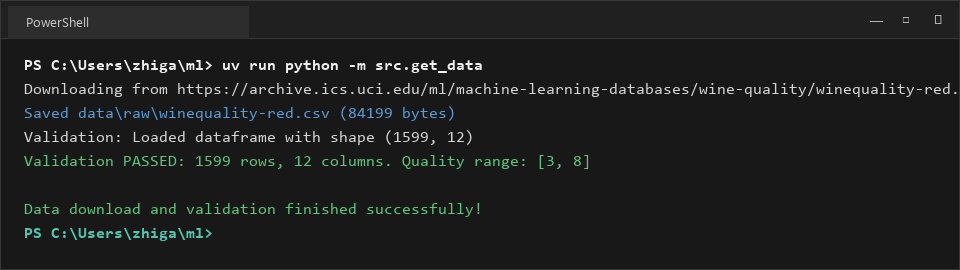
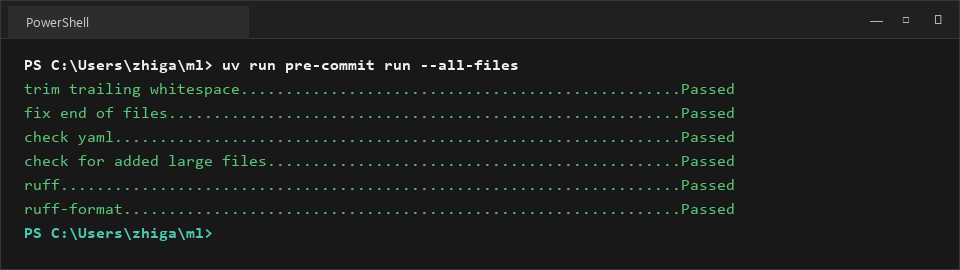
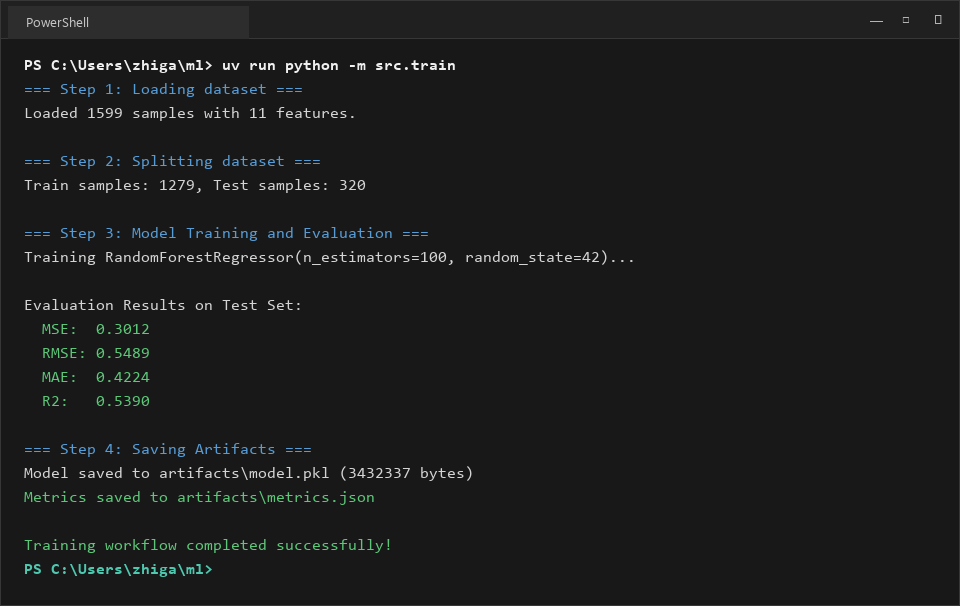

# Отчет по Домашнему заданию №1: Воспроизводимый ML-проект

## 1. Описание задачи

В рамках домашнего задания подготовлен воспроизводимый шаблон ML-проекта, настроены инструменты управления зависимостями (`uv`), статического анализа кода (`Ruff`, `pre-commit`), автоматизирована загрузка данных и реализовано обучение базовой модели с сохранением воспроизводимых артефактов.

В качестве единого датасета для всех заданий курса (ДЗ 1–6) выбран **Wine Quality Dataset (UCI Machine Learning Repository)**.
- **Задача:** Регрессия оценки качества вина (`quality`) на основе 11 физико-химических признаков.
- **Лицензия:** Creative Commons Attribution 4.0 International (CC BY 4.0).
- **Обоснование выбора:** Датасет компактен, скачивается по прямой ссылке без обязательных API-токенов, идеально подходит для быстрого CI/CD пайплайна и естественным образом поддерживает версионирование данных v1/v2 в ДЗ 2 (красное / белое вино).

---

## 2. Что было сделано

1. **Инициализация репозитория и окружения:**
   - Создан Git-репозиторий и настроен файл `.gitignore`: виртуальное окружение `.venv/`, сырые данные `data/raw/*`, бинарные веса `artifacts/*.pkl`, кэши и файл с заданием `5.homework.pdf` исключены из отслеживания.
   - Сформирован `pyproject.toml` с описанием метаданных и зависимостей, сгенерирован файл блокировки `uv.lock`.
   - Настроена синхронизация зависимостей через команду `uv sync --all-extras`.

2. **Конфигурация качества кода:**
   - Настроен статический анализатор и форматтер `Ruff` в `pyproject.toml` (правила `E`, `W`, `F`, `I`, `B`, `C4`, `UP`).
   - Настроен файл `.pre-commit-config.yaml` со стандартными хуками (`trailing-whitespace`, `end-of-file-fixer`, `check-yaml`, `check-added-large-files`) и хуками `ruff`, `ruff-format`.
   - Установлены Git-хуки командой `uv run pre-commit install`.

3. **Скрипт загрузки данных (`src/get_data.py`):**
   - Реализована функция автоматической загрузки датасета с нуля по URL из UCI ML Repository в каталог `data/raw/winequality-red.csv`.
   - Добавлена проверка существования файла, его размера и соответствия схеме колонок (валидация ожидаемых признаков и целевой переменной).
   - Предусмотрено чтение опционального токена авторизации из переменной окружения `DATASET_DOWNLOAD_TOKEN`.

4. **Скрипт обучения модели (`src/train.py`):**
   - Реализована загрузка данных, разбиение на обучающую и валидационную выборки (80/20 с фиксированным `random_state=42`).
   - Обучена модель `RandomForestRegressor(n_estimators=100, random_state=42)`.
   - Рассчитаны ключевые метрики качества регрессии: MSE, RMSE, MAE, R².
   - Реализовано гарантированное сохранение артефактов:
     - Обученная модель: `artifacts/model.pkl`
     - Валидный JSON с метриками: `artifacts/metrics.json`

5. **Документация:**
   - В `README.md` описана спецификация проекта, источник и лицензия данных, пошаговые команды установки, линтинга, загрузки данных и запуска обучения.

---

## 3. Скриншоты работы с инструментами

### Скриншот 1. Загрузка и валидация данных

Команда: `uv run python -m src.get_data`



*Скрипт загружает данные с нуля, проверяет структуру файла (1599 строк, 12 колонок, диапазон оценок [3, 8]) и не требует ручного скачивания.*

---

### Скриншот 2. Проверка качества кода pre-commit

Команда: `uv run pre-commit run --all-files`



*Все хуки (Ruff linter, Ruff formatter, check-yaml, trailing whitespace, end-of-file fixer, large files check) успешно пройдены.*

---

### Скриншот 3. Обучение модели и сохранение артефактов

Команда: `uv run python -m src.train`



*Обучение выполняется одной командой из зафиксированного окружения uv. По итогам создаются `artifacts/model.pkl` и `artifacts/metrics.json`.*

---

## 4. Результаты обучения и полученные метрики

По итогам запуска `uv run python -m src.train` на отложенной выборке (320 образцов) зафиксированы следующие метрики (`artifacts/metrics.json`):

| Метрика | Значение | Описание |
| :--- | :---: | :--- |
| **MSE** | `0.3012` | Среднеквадратичная ошибка |
| **RMSE** | `0.5489` | Корень из среднеквадратичной ошибки (в единицах шкалы качества) |
| **MAE** | `0.4224` | Средняя абсолютная ошибка |
| **R²** | `0.5390` | Коэффициент детерминации |

Содержимое файла `artifacts/metrics.json`:
```json
{
  "mse": 0.3012,
  "rmse": 0.5489,
  "mae": 0.4224,
  "r2": 0.539
}
```

---

## 5. Проверка критериев оценивания (8/8 баллов)

1. **Воспроизводимость (2 балла):**
   - Зависимости строго зафиксированы в `uv.lock`.
   - Окружение поднимается единой командой `uv sync --all-extras`.
   - Обучение запускается командой `uv run python -m src.train`.

2. **Получение данных (2 балла):**
   - Скрипт `uv run python -m src.get_data` загружает данные напрямую из репозитория UCI.
   - Выполняется строгая валидация колонок, размера и типа данных. Ручное копирование исключено.

3. **Качество кода (1 балл):**
   - Настроены Ruff и pre-commit.
   - Хуки проверяют форматирование, импорты, синтаксис и YAML-файлы.
   - Все проверки проходят со статусом `Passed`.

4. **Результат обучения (2 балла):**
   - Модель `artifacts/model.pkl` и валидный `artifacts/metrics.json` создаются заново при запуске и полностью соответствуют текущему прогону.

5. **Отчет и инструкция (1 балл):**
   - В `README.md` приведены подробные инструкции по развертыванию и запуску.
   - В данном отчете описаны этапы и приложены 3 скриншота работы инструментов.
